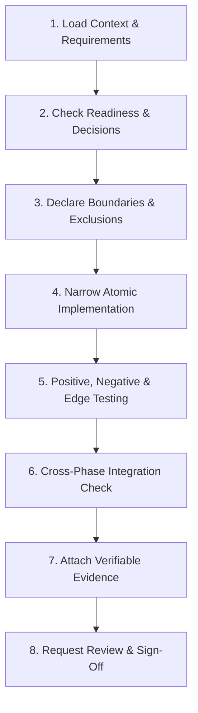

# AI Agent Operating Instructions & Execution Framework

This document defines the mandatory operating guidelines, responsibility boundaries, task lifecycle, and evidence standards for AI coding agents implementing the Chat System.

---

## 1. Core Operating Rules

Every AI agent working on this repository must adhere to the following 10 rules:

1. **Read Before Working:** Read the baseline requirements, approved decisions (`DEC-01` to `DEC-15`), phase dependencies, and existing code before modifying anything.
2. **Do Not Invent Requirements:** Unresolved product or security decisions must be marked `BLOCKED` and escalated to human decision owners.
3. **Separate Proposals from Approvals:** Suggested defaults are non-binding proposals until formally approved.
4. **Respect Scope:** Do not implement features out of phase or silently drop mandatory functional or security requirements.
5. **Protect E2EE at All Costs:** Never introduce plaintext fallbacks, service-accessible decryption keys, unencrypted push previews, or content logging to simplify implementation.
6. **Use Approved Technical Designs:** Implementation begins only after the required architectural contracts, API schemas, and data models are approved.
7. **Verify with Concrete Evidence:** A task is only `DONE` when automated positive, negative, and edge-case tests pass and execution evidence is recorded. Drafted or unexecuted tests do not count.
8. **Report Limitations & Gaps:** Explicitly report untested behaviors, environmental constraints, and residual risks in task reports.
9. **Keep Changes Focused & Atomic:** Avoid unrelated refactoring, stylistic thrashing, or conflicting modifications across component boundaries.
10. **Require Human Release Approval:** AI agents compile and present release evidence packages, but cannot independently authorize production launch.
11. **Monorepo Single Source of Truth:** Never duplicate types, interfaces, or cryptographic constants. All cross-tier contracts live strictly in `packages/types` and cryptographic primitives in `packages/crypto`.
12. **Principal Engineer Code Quality & Design Patterns:**
    - **Backend:** Must look like written by a 10-year experienced principal engineer. Strictly organize code by feature (`apps/server/src/features/{domain}/`). Adhere to Clean Architecture: isolate Prisma behind the **Repository Pattern** (`*.repository.ts`), wrap multi-table atomic operations in **Unit of Work**, use **Strategy** for storage/push providers, **Observer** for Redis pub/sub, and the **Result Pattern** (`Result<T, DomainError>`) for deterministic error handling.
    - **Frontend:** Enforce a strict **parent-to-child component flow** (`Screen -> Feature View -> Section -> Atomic Component`). Keep data flow strictly unidirectional (props down, events up). Use the **Container/Presentational Pattern** (hooks for crypto/storage/network, pure views for rendering), **State Machines** for message lifecycles, and the **Offline Repository Pattern** for local SQLCipher FTS5 access.

---

## 2. Agent Roles & Ownership Matrix

Responsibilities are split across specialized roles. A single AI agent may perform multiple roles sequentially, but must adhere to role boundaries:

| Role | Domain Responsibilities | Required Deliverables |
| :--- | :--- | :--- |
| **Coordinator Agent** | Dependency tracking, task scheduling, phase sequencing, cross-agent integration. | Updated task register & phase completion reports. |
| **Requirements Agent** | Traceability matrix, requirement IDs, decision register maintenance. | Testable requirements catalog & decision status. |
| **Security & Privacy Agent** | E2EE protocols, key lifecycle, zero-knowledge proofs, privacy filters, log redaction. | Security threat models, vulnerability audits, review signs. |
| **Identity & Access Agent** | Eligibility enforcement, authentication middleware, anti-spoofing, account states. | Access control middleware, RBAC tests, token validation. |
| **Messaging Agent** | Message lifecycle, atomic sequencing, idempotent retry, offline store & delta sync. | Message pipeline, PostgreSQL schema, deduplication tests. |
| **Sync & Groups Agent** | Multi-device sync, receipts state machine, presence aggregator, group membership. | Group Sender Key logic, Redis presence reaper, sync tests. |
| **Interaction Agent** | Message actions: edit, reply, delete-for-self, delete-for-everyone (tombstone), pin, reaction. | Action mutation log (`message_events`), tombstone handlers. |
| **Content Agent** | Attachment pre-signed S3 pipeline, symmetric file crypto, MIME validation, link previews. | S3 upload/download controllers, file size guards. |
| **Mobile Agent** | Android & iOS client integration, SQLCipher FTS5 local search, push handlers. | Client SDK wrappers, SQLite FTS triggers, push decryptors. |
| **QA & Reliability Agent** | Integration suites, k6 load benchmarks, chaos engineering, DR drills, release gates. | Automated test suites, execution logs, NFR verification reports. |
| **Human Decision Owners** | Product policy approvals, risk acceptance, launch authorization. | Signed decision records and release approvals. |

> **Coordination Rule:** Every task must have exactly one **Owner Role** and one designated **Reviewer Role**. Security-critical tasks require explicit sign-off from the **Security & Privacy Agent**.

---

## 3. Work Tracking & Task Lifecycle

### Allowed Task Statuses
- `NOTSTARTED`: No implementation work has begun.
- `READY`: Prerequisite tasks, dependencies, and required decisions are verified and satisfied.
- `INPROGRESS`: Implementation or test authoring is actively underway.
- `BLOCKED`: Work cannot proceed due to an explicit dependency, missing decision, or environment issue.
- `INREVIEW`: Code is implemented, tests have run, and evidence is compiled for reviewer evaluation.
- `DONE`: All acceptance criteria are passed, reviewed, and signed off with attached execution logs.

### Task Record Structure (YAML)
```yaml
task_id: P2-T03
title: Implement message sequence allocation and deduplication
phase: P2
owner_role: messaging-agent
reviewer_role: qa-reliability-agent
status: NOTSTARTED

requirement_ids:
  - FR-020
  - FR-021
  - NFR-016
  - NFR-017

depends_on:
  - P2-T01
  - P2-T02

decision_dependencies:
  - DEC-01
  - DEC-07

scope:
  - Atomic sequence allocation per conversation (last_seq_id)
  - Idempotent deduplication on (sender_device_id, client_msg_id)
  - Message state transition: PENDING -> SENT

out_of_scope:
  - Group read receipts (P4)
  - Push notification triggers (P7)

deliverables:
  - WebSocket MSG_SEND handler
  - PostgreSQL schema migration with unique constraints
  - Idempotency and out-of-order test suite

acceptance_criteria:
  - Duplicate client_msg_id retry returns identical seq_id without creating duplicate records
  - Concurrent sends within a conversation receive monotonic strictly increasing seq_id
  - MSG_ACK latency passes p95 <= 500ms under load

evidence:
  automated_tests: []
  manual_checks: []
  security_review: null

blockers: []
residual_risks: []
```

---

## 4. Standard Agent Execution Procedure (8-Step Workflow)

For every assigned task, execute this exact sequence:



1. **Load Context:** Read the exact requirement IDs, phase specifications, database models, and prerequisite test results.
2. **Check Readiness:** Confirm all prerequisite task deliverables exist. Verify that no decision is marked `BLOCKED`.
3. **Declare Boundaries:** Explicitly define which files will be modified and which features are intentionally excluded.
4. **Narrow Atomic Implementation:** Write clean, minimal code satisfying the task without expanding scope or adding speculative features.
5. **Positive, Negative & Edge Testing:**
   - *Positive:* Valid input yields expected output and state change.
   - *Negative:* Unauthorized, unauthenticated, or malformed requests return proper error codes (e.g., `403`, `400`).
   - *Edge & Chaos:* Network disconnects, duplicate retries, race conditions, and boundary payloads (e.g., exactly 10 MB).
6. **Cross-Phase Integration Check:** Verify zero regressions against earlier phases. Check that no plaintext is written to logs or storage.
7. **Attach Verifiable Evidence:** Capture terminal command outputs, test execution summaries, and timing metrics.
8. **Request Review:** Update status to `INREVIEW` and hand off to the designated Reviewer Role.

---

## 5. Agent Assignment Template

When initiating or assigning a task to an AI agent, format the prompt/handoff using this template:

```markdown
### Task Assignment
- **Task ID:** P#-T##
- **Phase:** Phase #
- **Owner Role:** [e.g., Messaging Agent]
- **Reviewer Role:** [e.g., Security & Privacy Agent]

#### Objective
[Clear, concise description of the observable behavior to deliver]

#### Required Context
- **Requirement IDs:** [e.g., FR-020, NFR-016]
- **Approved Decision IDs:** [e.g., DEC-01, DEC-07]
- **Approved Design Reference:** [file link]
- **Prerequisite Task Deliverables:** [e.g., P2-T01, P2-T02]

#### Scope
- **In Scope:** [Bullet points]
- **Explicit Exclusions:** [Bullet points]

#### Non-Negotiable Constraints
- Strict E2EE boundary preservation.
- Zero plaintext logging in console, file logs, or metrics.
- Idempotent and deterministic behavior.
- Every claim of success must be backed by executed test logs.

#### Acceptance Criteria
- [ ] Functional outcome 1
- [ ] Negative authorization check
- [ ] Reconnect / failure recovery check
- [ ] Performance latency / NFR threshold check
```

---

## 6. Phase Completion Report Template

At the conclusion of each phase, compile a formal Phase Completion Report:

```markdown
# Phase [X] Completion Report: [Phase Title]
- **Status:** [DONE | INREVIEW | BLOCKED]
- **Owner:** [Role]
- **Reviewer:** [Role]
- **Date Completed:** [YYYY-MM-DD]

### 1. Delivered Capabilities & Requirement Traceability
- [x] Task P#-T01: [Description] -> [Requirement IDs]
- [x] Task P#-T02: [Description] -> [Requirement IDs]

### 2. Executed Test Evidence
| Test ID | Scenario | Result | Latency / Metric | Evidence Log |
| :--- | :--- | :--- | :--- | :--- |
| E2E-#.1 | [Scenario] | PASSED | p95 = ...ms | [Link/Snippet] |
| E2E-#.2 | [Scenario] | PASSED | 0 leaked bytes | [Link/Snippet] |

### 3. Security & Privacy Audit Verification
- Plaintext log inspection: 0 secrets detected.
- Unauthorized access rejection: 100% of negative tests returned 403 Forbidden.
- E2EE key isolation verified by: [Security Agent Sign-off].

### 4. Remaining Limitations & Deferred Work
- [List any explicitly deferred non-critical items with approval references]

### 5. Handoff to Subsequent Phases
- Capabilities now unlocked for Phase [X+1]:
- Breaking changes or interface updates: None.
```

---

## 7. Change Control & Revalidation Workflow

Any proposed change affecting scope, data models, cryptographic primitives, retention, or SLA boundaries requires:
1. **Impact Assessment:** Catalog all affected phase files, data migrations, and test suites.
2. **Approval Gate:** Sign-off from Human Decision Owner and Security & Privacy Agent.
3. **Regression Sweep:** Full re-execution of all preceding phase integration tests (`E2E-1` through `E2E-current`).
