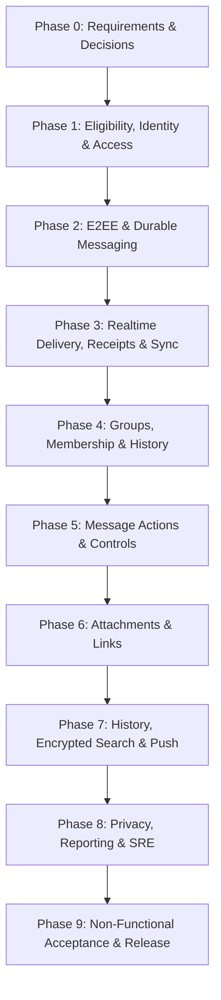

# Chat System — AI Agent Implementation & Phase Registry

This directory contains the complete modular specifications, data models, protocols, and test suites for the 10 execution phases (`P0` through `P9`) based on **Chat System AI Agent Delivery Plan v2.0**.

---

## 📑 Core Documentation & Instructions

- **Master Technical Blueprint:** [`10-architecture-tech-stack-and-monorepo.md`](file:///Users/devarpit/Desktop/chat-app/phases/10-architecture-tech-stack-and-monorepo.md) — Monorepo topology (pnpm/Turbo), Fastify/Node.js feature-based backend, React Native parent-to-child component hierarchy, Supabase + Prisma schema, Docker environment, and k6 test harness.
- **AI Agent Operating Guidelines:** [`AGENT_OPERATING_INSTRUCTIONS.md`](file:///Users/devarpit/Desktop/chat-app/phases/AGENT_OPERATING_INSTRUCTIONS.md) — 10 mandatory agent rules, role responsibility matrix, YAML task template, standard 8-step workflow, and phase completion report format.
- **Environment & Credentials:** Root [`.env`](file:///Users/devarpit/Desktop/chat-app/.env) / [`.env.example`](file:///Users/devarpit/Desktop/chat-app/.env.example) — Configured with dual Supabase connection strings (transaction pooler on port 6543, direct session on 5432).

---

## 🚀 Phase Specifications Index

| File | Phase | Primary Owner | Summary & Deliverables |
| :--- | :--- | :--- | :--- |
| [`10-architecture-tech-stack-and-monorepo.md`](file:///Users/devarpit/Desktop/chat-app/phases/10-architecture-tech-stack-and-monorepo.md) | **Technical Architecture** | Principal Architect | Monorepo layout, feature-based clean architecture, React Native parent-child flow, complete Prisma Supabase schema, Docker, and k6 harness. |
| [`00-phase0-requirements-and-approvals.md`](file:///Users/devarpit/Desktop/chat-app/phases/00-phase0-requirements-and-approvals.md) | **P0: Requirements & Approvals** | Requirements Agent | 15 mandatory product/security decisions (`DEC-01` to `DEC-15`), scale targets (10k users, India Multi-AZ, 99.9% SLA, RPO=0, RTO≤4h), and technical design handoff. |
| [`01-phase1-eligibility-identity-and-access.md`](file:///Users/devarpit/Desktop/chat-app/phases/01-phase1-eligibility-identity-and-access.md) | **P1: Eligibility, Identity & Access** | Identity & Access Agent | Verified eligibility gate, JWT anti-spoofing, deterministic 1:1 conversation upsert (`direct_pair_hash`), conversation listing, and account suspension kill-switch. |
| [`02-phase2-e2ee-and-durable-messaging.md`](file:///Users/devarpit/Desktop/chat-app/phases/02-phase2-e2ee-and-durable-messaging.md) | **P2: E2EE & Durable Messaging** | Messaging Agent / Security Agent | Multi-device X3DH key bundles, atomic OPK consumption, Argon2id Zero-RPO key backup vault, atomic `seq_id` ordering, deduplication, and offline queuing. |
| [`03-phase3-realtime-delivery-receipts-and-device-sync.md`](file:///Users/devarpit/Desktop/chat-app/phases/03-phase3-realtime-delivery-receipts-and-device-sync.md) | **P3: Realtime Delivery, Receipts & Sync** | Sync & Groups Agent | Live WebSocket fan-out (`p95 ≤ 1s`), monotonic receipts (`1 → 2 → 3`), multi-device read sync (`READ_UP_TO`), Redis presence aggregator (45s TTL), and typing indicators. |
| [`04-phase4-groups-membership-and-historical-access.md`](file:///Users/devarpit/Desktop/chat-app/phases/04-phase4-groups-membership-and-historical-access.md) | **P4: Groups, Membership & History** | Sync & Groups Agent | 100-member group ceiling, role RBAC, 100-message pre-join history boundary (`history_floor_seq_id`), Group Sender Key rotation forward secrecy, and automatic owner succession. |
| [`05-phase5-message-actions-and-conversation-controls.md`](file:///Users/devarpit/Desktop/chat-app/phases/05-phase5-message-actions-and-conversation-controls.md) | **P5: Message Actions & Controls** | Interaction Agent | Quoted replies, message edits (48h window), delete-for-self vs. delete-for-everyone (tombstone payload nulling), reactions, re-encrypted forwarding, pins, and mute. |
| [`06-phase6-attachments-and-links.md`](file:///Users/devarpit/Desktop/chat-app/phases/06-phase6-attachments-and-links.md) | **P6: Attachments & Links** | Content Agent / Security Agent | S3 pre-signed upload/download (≤ 10 MB limit), client-side symmetric AES-256-GCM encryption, MIME whitelist & executable blocker, encrypted thumbnails, and tombstone S3 purge. |
| [`07-phase7-history-encrypted-search-and-notifications.md`](file:///Users/devarpit/Desktop/chat-app/phases/07-phase7-history-encrypted-search-and-notifications.md) | **P7: History, Search & Notifications** | Mobile Agent / Content Agent | Paged history retrieval (`p95 ≤ 1s`), on-device SQLCipher FTS5 content search (`p95 ≤ 2s`), zero-plaintext server guarantee, and push notifications with background OS decrypt. |
| [`08-phase8-privacy-reporting-and-data-lifecycle.md`](file:///Users/devarpit/Desktop/chat-app/phases/08-phase8-privacy-reporting-and-data-lifecycle.md) | **P8: Privacy, Reporting & SRE** | Security Agent / Identity Agent | Bidirectional user blocking, scoped cryptographic moderation disclosure (`Mod_PK`), immutable write-ahead audit logs, Redis rate limiters, and post-restore tombstone scrubbing. |
| [`09-phase9-non-functional-acceptance-and-release.md`](file:///Users/devarpit/Desktop/chat-app/phases/09-phase9-non-functional-acceptance-and-release.md) | **P9: Non-Functional Acceptance & Release** | QA & Reliability Agent | Cross-phase E2E scenarios (`E2E-M01` to `E2E-M04`), k6 load benchmarks, chaos failover drills (RPO=0, RTO≤4h), 99.9% availability probes, and the 12-gate final release checklist. |

---

## 🔄 Delivery Sequence & Phase Dependencies

---

## 🛠️ Execution Protocol for AI Agents

1. **Context Initialization:** Consult [`AGENT_OPERATING_INSTRUCTIONS.md`](file:///Users/devarpit/Desktop/chat-app/phases/AGENT_OPERATING_INSTRUCTIONS.md) for behavioral rules, role definitions, and task templates.
2. **Sequential Phase Delivery:** Never begin Phase N+1 until Phase N has passed its acceptance tests and received sign-off.
3. **Evidence Requirement:** Every completed task must record test command outputs, assertion checks, and latency metrics.
