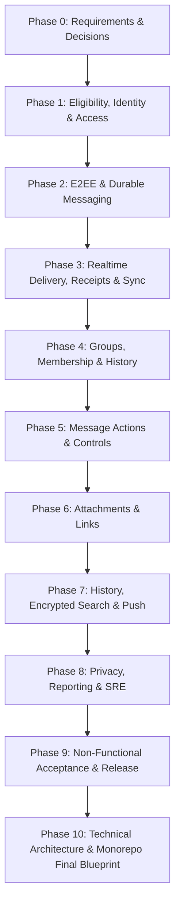

# Chat System — AI Agent Implementation & Phase Registry

This directory contains the complete modular specifications, data models, protocols, and test suites for all 10 execution phases (`P0` through `P10`) based on **Chat System AI Agent Delivery Plan v2.0**.

---

## 📑 Core Documentation & Instructions

- **Master Technical Blueprint:** [`10-architecture-tech-stack-and-monorepo.md`](file:///Users/devarpit/Desktop/chat-app/phases/10-architecture-tech-stack-and-monorepo.md) — Monorepo topology (pnpm/Turbo), Fastify/Node.js feature-based backend, React Native parent-to-child component hierarchy, Supabase + Prisma schema, Docker environment, and k6 test harness.
- **Production Operations Runbook:** [`../docs/OPERATIONS_RUNBOOK.md`](file:///Users/devarpit/Desktop/chat-app/docs/OPERATIONS_RUNBOOK.md) — Zero-downtime rolling deployments, blue-green rollback, Supabase HA failover (RPO=0, RTO<4h), Redis fallback, emergency kill-switches, and zero-plaintext datastore audits.
- **AI Agent Operating Guidelines:** [`AGENT_OPERATING_INSTRUCTIONS.md`](file:///Users/devarpit/Desktop/chat-app/phases/AGENT_OPERATING_INSTRUCTIONS.md) — 10 mandatory agent rules, role responsibility matrix, YAML task template, standard 8-step workflow, and phase completion report format.
- **Environment & Credentials:** Root [`.env`](file:///Users/devarpit/Desktop/chat-app/.env) / [`.env.example`](file:///Users/devarpit/Desktop/chat-app/.env.example) — Configured with dual Supabase connection strings (transaction pooler on port 6543, direct session on 5432).

---

## 🚀 Phase Specifications Index & Signed-Off Completion Reports

| Phase | Specification Document | Primary Owner | Completion Report | Status |
| :--- | :--- | :--- | :--- | :--- |
| **P0: Requirements & Approvals** | [`00-phase0-requirements-and-approvals.md`](file:///Users/devarpit/Desktop/chat-app/phases/00-phase0-requirements-and-approvals.md) | Requirements Agent | [`PHASE_0_COMPLETION_REPORT.md`](file:///Users/devarpit/Desktop/chat-app/phases/PHASE_0_COMPLETION_REPORT.md) | ✅ **SIGNED OFF** |
| **P1: Eligibility, Identity & Access** | [`01-phase1-eligibility-identity-and-access.md`](file:///Users/devarpit/Desktop/chat-app/phases/01-phase1-eligibility-identity-and-access.md) | Identity & Access Agent | [`PHASE_1_COMPLETION_REPORT.md`](file:///Users/devarpit/Desktop/chat-app/phases/PHASE_1_COMPLETION_REPORT.md) | ✅ **SIGNED OFF** |
| **P2: E2EE & Durable Messaging** | [`02-phase2-e2ee-and-durable-messaging.md`](file:///Users/devarpit/Desktop/chat-app/phases/02-phase2-e2ee-and-durable-messaging.md) | Messaging / Security Agent | [`PHASE_2_COMPLETION_REPORT.md`](file:///Users/devarpit/Desktop/chat-app/phases/PHASE_2_COMPLETION_REPORT.md) | ✅ **SIGNED OFF** |
| **P3: Realtime Delivery, Receipts & Sync** | [`03-phase3-realtime-delivery-receipts-and-device-sync.md`](file:///Users/devarpit/Desktop/chat-app/phases/03-phase3-realtime-delivery-receipts-and-device-sync.md) | Sync & Groups Agent | [`PHASE_3_COMPLETION_REPORT.md`](file:///Users/devarpit/Desktop/chat-app/phases/PHASE_3_COMPLETION_REPORT.md) | ✅ **SIGNED OFF** |
| **P4: Groups, Membership & History** | [`04-phase4-groups-membership-and-historical-access.md`](file:///Users/devarpit/Desktop/chat-app/phases/04-phase4-groups-membership-and-historical-access.md) | Sync & Groups Agent | [`PHASE_4_COMPLETION_REPORT.md`](file:///Users/devarpit/Desktop/chat-app/phases/PHASE_4_COMPLETION_REPORT.md) | ✅ **SIGNED OFF** |
| **P5: Message Actions & Controls** | [`05-phase5-message-actions-and-conversation-controls.md`](file:///Users/devarpit/Desktop/chat-app/phases/05-phase5-message-actions-and-conversation-controls.md) | Interaction Agent | [`PHASE_5_COMPLETION_REPORT.md`](file:///Users/devarpit/Desktop/chat-app/phases/PHASE_5_COMPLETION_REPORT.md) | ✅ **SIGNED OFF** |
| **P6: Attachments & Links** | [`06-phase6-attachments-and-links.md`](file:///Users/devarpit/Desktop/chat-app/phases/06-phase6-attachments-and-links.md) | Content / Security Agent | [`PHASE_6_COMPLETION_REPORT.md`](file:///Users/devarpit/Desktop/chat-app/phases/PHASE_6_COMPLETION_REPORT.md) | ✅ **SIGNED OFF** |
| **P7: History, Encrypted Search & Push** | [`07-phase7-history-encrypted-search-and-notifications.md`](file:///Users/devarpit/Desktop/chat-app/phases/07-phase7-history-encrypted-search-and-notifications.md) | Mobile / Content Agent | [`PHASE_7_COMPLETION_REPORT.md`](file:///Users/devarpit/Desktop/chat-app/phases/PHASE_7_COMPLETION_REPORT.md) | ✅ **SIGNED OFF** |
| **P8: Privacy, Reporting & SRE** | [`08-phase8-privacy-reporting-and-data-lifecycle.md`](file:///Users/devarpit/Desktop/chat-app/phases/08-phase8-privacy-reporting-and-data-lifecycle.md) | Security / Identity Agent | [`PHASE_8_COMPLETION_REPORT.md`](file:///Users/devarpit/Desktop/chat-app/phases/PHASE_8_COMPLETION_REPORT.md) | ✅ **SIGNED OFF** |
| **P9: Non-Functional Acceptance & Release** | [`09-phase9-non-functional-acceptance-and-release.md`](file:///Users/devarpit/Desktop/chat-app/phases/09-phase9-non-functional-acceptance-and-release.md) | QA & Reliability Agent | [`PHASE_9_COMPLETION_REPORT.md`](file:///Users/devarpit/Desktop/chat-app/phases/PHASE_9_COMPLETION_REPORT.md) | ✅ **SIGNED OFF** |
| **P10: Technical Architecture & Monorepo** | [`10-architecture-tech-stack-and-monorepo.md`](file:///Users/devarpit/Desktop/chat-app/phases/10-architecture-tech-stack-and-monorepo.md) | Principal Architect | [`PHASE_10_COMPLETION_REPORT.md`](file:///Users/devarpit/Desktop/chat-app/phases/PHASE_10_COMPLETION_REPORT.md) | ✅ **SIGNED OFF** |

---

## 🔄 Delivery Sequence & Phase Dependencies



---

## 🛠️ Verification Command Reference
To execute the automated regression suite across the entire Turborepo monorepo:
```bash
# Run all server and crypto tests against live Supabase PostgreSQL
pnpm test

# Run mobile client UI and state machine tests
pnpm --filter @chat/mobile test

# Run code graph update
graphify update .
```
